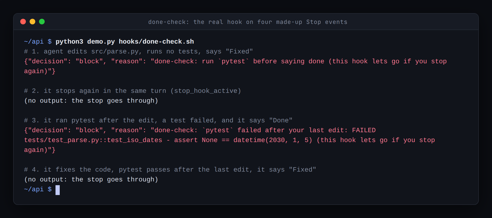

# done-check
Stops your Claude Code agent from saying "done" until your tests have passed after its last code change.



The real hook answering four made-up Stop events.

```
claude plugin marketplace add kilazi/done-check && claude plugin install done-check@kilazi
```

Restart Claude Code. If the agent edits code and says done without a passing test run, it is sent back once to run your tests; a second stop goes through.
Works with npm, pnpm, yarn, bun, pytest, cargo, go, make or your own command. Needs python3. Off: `export DONE_CHECK=off`.

## Why not a CLAUDE.md rule or a test-on-stop hook?
A "run the tests before you say done" line in CLAUDE.md is a request the agent can skip. A hook that runs the suite on every stop makes each stop as slow as your tests, even when no code changed.
done-check runs nothing itself. It reads the session transcript and steps in only when the final message claims done or fixed after a code edit (docs don't count) and no passing run of your test command came after the last edit.
Then it sends the agent back once with the command to run, or the failing test it saw. The second stop goes through, so it never traps a session. Test failures that were already there before the edit are ignored by default.

Apache-2.0. Reusing it? Keep the NOTICE: credit kilazi/done-check.

More: https://kilazi.com/wiki/done-check/ · by kilazi
